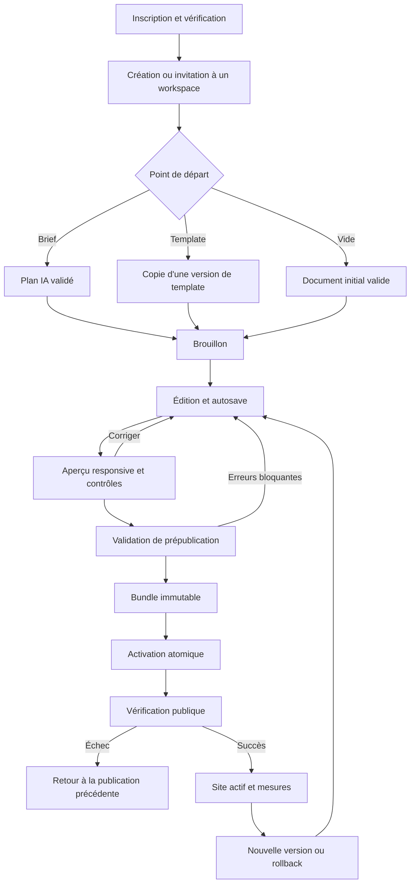

# 01 — Vision produit et scénarios utilisateurs

## 1. Finalité

WOOBET vise une plateforme mondiale de création numérique visuelle, assistée par IA et extensible. Le principe directeur est la **divulgation progressive de la complexité** : un débutant agit sur des contenus et des sections sûres ; un professionnel peut ouvrir l'arborescence, les contraintes responsive, les données, les interactions et les intégrations sans changer de moteur.

La promesse mesurable n'est pas « tout créer automatiquement ». Elle est : **produire un document valide, le modifier sans corruption, le prévisualiser fidèlement et publier une version traçable et réversible**. Les modules métier ajoutent ensuite leurs propres garanties.

## 2. Publics et besoins

| Persona | Objectif | Compétence supposée | Besoins essentiels | Risque UX à éviter |
|---|---|---|---|---|
| Créateur débutant | Mettre en ligne un site professionnel | Aucune programmation | Brief guidé, sections sûres, textes/images, aperçu, publication | Options techniques visibles trop tôt |
| Responsable de petite entreprise | Présenter offres, contacs et contenus locaux | Bureautique | Multilingue, formulaires, SEO, domaine, analytics consentis | Réglages distribués sans vue d'ensemble |
| Designer | Contrôler une identité et des layouts | Design systems | Tokens, variantes, grilles, styles hérités, responsive, composants | Éditeur qui dénature le design |
| Agence | Produire plusieurs sites et déléguer | Gestion de projets | Workspaces, rôles, bibliothèques privées, duplication, quotas, audit | Collisions entre clients et pertes de versions |
| Développeur | Étendre sans contourner le socle | API, TypeScript, intégrations | Schéma public, SDK futur, webhooks, composants déclaratifs, sandbox | Scripts arbitraires sur le domaine principal |
| Contributeur/contenu | Modifier des contenus sans casser la structure | Métier éditorial | Permissions champ/composant, workflows de relecture futurs | Droits trop larges ou interface complète |
| Administrateur de workspace | Gérer membres, domaines, facturation | Administration | RBAC, invitations, journal, quotas, facturation | Élévation de privilèges par API |
| Équipe support/exploitation | Diagnostiquer sans lire les secrets | Ops/support | Identifiants de corrélation, états de publication/domaine, audit | Accès transversal implicite aux contenus |

## 3. Principes produit

1. **Un seul document, plusieurs projections.** Le brouillon, l'aperçu et le site publié partagent la sémantique du schéma, mais pas les mêmes données ni les mêmes bundles logiciels.
2. **Simple par défaut, avancé à la demande.** Le mode avancé ajoute des panneaux ; il ne change pas les règles sous-jacentes.
3. **Sûr par construction.** Un composant inconnu, une ressource absente ou une sortie IA invalide produit une erreur contrôlée, jamais une exécution arbitraire.
4. **Réversible.** Les commandes sont annulables ; les publications sont versionnées ; les changements de domaine et suppressions ont des états et des confirmations.
5. **Le contenu appartient au tenant.** Export, rétention et suppression sont conçus dès le modèle de données.
6. **International dès le modèle.** Langue d'interface, locales de contenu, devise, formats régionaux et fuseau horaire sont des données séparées.
7. **Aucune promesse de capacité sans mesure.** Les seuils de performance, disponibilité et montée en charge sont des cibles testables.
8. **Le moteur ne simule pas le métier.** Un composant « réservation » n'affiche une action réelle que si un module de disponibilité et de réservation est installé et configuré.

## 4. Cartographie des capacités

### 4.1 Moteur commun — socle

- documents, pages, sections, composants, styles et tokens ;
- navigation, routes, locales et métadonnées ;
- registre de composants, thèmes et templates ;
- édition, aperçu, historique et publication ;
- médias, liens, formulaires génériques et redirections ;
- permissions, audit, quotas, événements et webhooks ;
- API d'extension déclarative et collections à périmètre contrôlé.

### 4.2 Modules métier — extensions

| Domaine | Socle réutilisable | Services supplémentaires obligatoires | Niveau proposé |
|---|---|---|---|
| Vitrine/entreprise/portfolio | Pages, médias, thème, SEO | Formulaire et consentement | V1 |
| Blog/magazine/actualités | Collections, catégories, auteurs, flux | Workflow éditorial, recherche, planification | Collections simples en V1 ; avancé ultérieur |
| Landing/page de vente | Sections, formulaires, variantes | Événements de conversion, intégrations marketing | V1 technique ; intégrations au cas par cas |
| Restaurant/hôtel | Pages, menus comme collection, galeries, carte | Disponibilités, réservations, notifications, fuseaux, no-show | Menu V1 ; réservation module ultérieur |
| E-commerce | Collections et pages produit | Panier, commande, paiement, taxes, stocks, livraison, retours | Hors V1 complète |
| École/formation | Pages, comptes et collections | Cours structurés, inscription, progression, permissions apprenant | Hors V1 complète |
| Annuaire/immobilier/emploi/petites annonces | Collections, filtres, recherche | Modération, ingestion, recherche, paiements éventuels | Pilote après Collections |
| Événements/communauté/espaces membres | Pages, formulaires, identité | Inscription, billets, permissions de contenu, modération | Modules ultérieurs |
| Portail client/dashboard/outil métier/SaaS | Collections, permissions, API | Auth des utilisateurs finaux, règles métier, transactions, workflows | Fondations seulement |
| Marketplace multi-vendeurs | Tout ce qui précède | KYC, payouts, litiges, commissions, modération, conformité | Produit/module distinct à spécifier |

## 5. Parcours utilisateur de référence

## 6. Scénarios détaillés

### US-01 — Création guidée d'un site vitrine

**Acteur :** débutant. **Préconditions :** email vérifié, quota de projet disponible.
**Étapes :** choisir une langue de contenu ; décrire l'activité ; vérifier le plan de pages ; choisir une direction visuelle ; générer ; modifier textes/images ; prévisualiser trois breakpoints ; publier sur un sous-domaine disponible.
**Règles :** l'utilisateur peut ignorer l'IA ; toute image proposée indique son origine et ses droits ; le slug est réservé côté serveur ; les erreurs n'effacent pas le brouillon.
**Acceptation :** parcours réalisable sans ouvrir le mode avancé ; reprise après fermeture ; document conforme ; aucune ressource privée temporaire dans le site public.

### US-02 — Refonte par un designer

**Acteur :** designer éditeur. **Étapes :** dupliquer un projet ou créer une branche de travail future ; modifier les tokens ; définir une variante Hero ; ouvrir l'arborescence ; ajuster une grille et des overrides mobile ; comparer au checkpoint précédent ; publier.
**Règles :** les tokens hérités sont distingués des valeurs locales ; une suppression de token utilisée est bloquée ou migrée ; la fidélité entre aperçu et publication est testée.

### US-03 — Production multi-clients par une agence

**Acteur :** administrateur d'agence. **Étapes :** créer des workspaces séparés ou une organisation avec projets clients selon le modèle validé ; inviter des contributeurs ; importer un template privé ; attribuer les domaines ; suivre quotas et audits.
**Règle critique :** aucune liste, recherche, asset, API ou export ne retourne un objet d'un autre workspace ; un support n'obtient un accès temporaire qu'avec une procédure auditée.

### US-04 — Modification IA à portée limitée

**Acteur :** éditeur. **Entrée :** « Rends cette section plus premium sans changer les autres sections ni les textes ».
**Déroulement :** l'agent identifie la cible et la révision ; produit un patch de commandes ; le serveur vérifie que chaque chemin modifié appartient à la portée ; l'utilisateur voit le diff et accepte ; annuler restaure exactement l'état précédent.
**Refus :** si la révision est obsolète, si le patch touche un nœud interdit ou si le résultat viole le schéma, rien n'est appliqué.

### US-05 — Connexion d'un domaine existant

**Acteur :** propriétaire/admin. **Étapes :** saisir le FQDN ; obtenir un challenge TXT ; vérifier la propriété ; recevoir les instructions DNS ; lancer les contrôles asynchrones ; provisionner TLS ; activer ; surveiller.
**Règles :** aucun domaine n'est actif avant preuve de propriété et routage sûr ; les états et erreurs sont actionnables ; `http` redirige vers `https` après activation ; un échec de certificat ne casse pas l'ancienne publication.

### US-06 — Restauration après une mauvaise publication

**Acteur :** éditeur autorisé. **Étapes :** ouvrir l'historique ; comparer ; sélectionner une publication saine ; confirmer le rollback ; le système crée une nouvelle activation pointant vers le bundle historique.
**Règle :** le rollback ne réécrit pas l'historique et ne supprime pas le brouillon courant ; le résultat est audité.

### US-07 — Contenu multilingue

**Acteur :** contributeur. **Étapes :** ajouter une locale ; dupliquer une structure ou créer des traductions ; renseigner les champs localisés ; définir les slugs ; contrôler `hreflang`, canonique et sitemap ; publier les locales sélectionnées.
**Règle :** une traduction IA est un brouillon ; la langue de l'interface de gestion ne change pas le contenu du site.

### US-08 — Formulaire et consentement

**Acteur :** éditeur. **Étapes :** ajouter un formulaire ; configurer champs, validation, destination, message, consentement et rétention ; tester ; publier.
**Règles :** validation serveur, anti-automatisation proportionné, limite de débit, notifications sans secrets dans le document ; données exportables/supprimables.

## 7. Règles de composition et diversité

La diversité théorique est le produit des choix de structures, composants, variantes, tokens et contenus, **moins les combinaisons interdites**. Si une section possède `L` layouts, `C` palettes, `T` traitements typographiques et `S` espacements, le nombre naïf est `L × C × T × S`. Ce chiffre n'est pas un nombre de designs de qualité : certaines palettes sont équivalentes perceptuellement, certains layouts sont incompatibles et les contenus contraignent la composition.

WOOBET mesurera donc séparément :

- `C_théorique` : nombre calculé sur les paramètres autorisés ;
- `C_valide` : sous-ensemble validé par schéma et règles de compatibilité ;
- `C_perceptible` : clusters après normalisation des différences visuelles non significatives ;
- `C_acceptable` : échantillon satisfaisant accessibilité, responsive et revue de qualité.

Le générateur classe les résultats selon adéquation au brief, cohérence des tokens, contraste, densité, équilibre, diversité par rapport aux propositions précédentes et compatibilité du contenu. Aucune affirmation de « possibilités illimitées » n'est utilisée comme critère technique.

## 8. Indicateurs produit

Sans collecte excessive : temps jusqu'au premier document valide ; taux de première publication ; pourcentage de générations acceptées sans correction structurelle ; fréquence d'annulation après IA ; temps de modification d'un texte ; taux de rollback ; succès de connexion de domaine ; rétention par cohorte ; utilisation simple/avancé ; erreurs de schéma ; satisfaction après génération. Les événements sont pseudonymisés, soumis à rétention et décrits dans les documents 19 et 20.

## 9. Non-objectifs de la première architecture

- reproduire librement tout le web ou importer arbitrairement du code externe ;
- garantir une esthétique professionnelle pour toute combinaison ;
- fournir un langage de programmation général dans le navigateur ;
- héberger du code utilisateur non isolé sur les domaines de gestion ;
- supporter dès le départ une collaboration temps réel ou un multi-région actif-actif ;
- faire de l'IA une autorité capable de publier, modifier la facturation ou changer les permissions.
