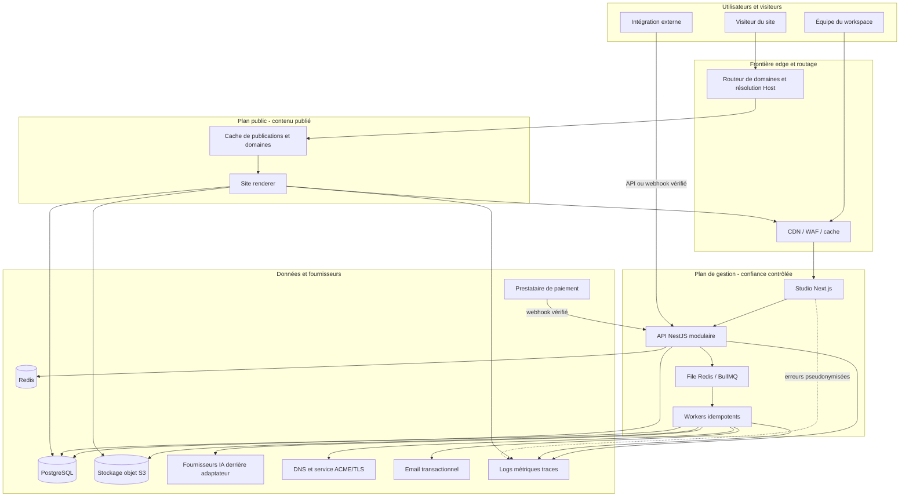
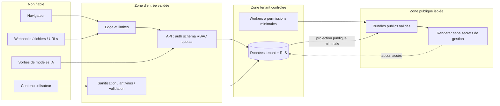

# 04 — Architecture système globale

## 1. Style architectural

**Recommandation :** monolithe backend modulaire dans un monorepo, avec séparation physique des points d'entrée Studio, API, worker et renderer public. Cette séparation ne constitue pas une architecture de microservices : les modules partagent initialement une base et un cycle de release, mais communiquent par contrats explicites et tâches durables.

Les principes sont : état durable dans PostgreSQL/objet ; applications stateless ; aucune requête synchrone au fournisseur IA/DNS sur le chemin public ; bundles immuables ; frontière de confiance entre gestion et visiteurs ; toutes les opérations sensibles auditées.

## 2. Carte des applications et packages

| Élément | Responsabilité | Ne doit jamais faire |
|---|---|---|
| `apps/studio` | Interface de gestion et éditeur ; appels API authentifiés | Accéder directement à PostgreSQL ou aux secrets serveur |
| `apps/api` | REST `/v1`, auth, RBAC, tenants, commandes, orchestration | Servir du JavaScript utilisateur arbitraire |
| `apps/worker` | IA, médias, bundles, domaines, emails, webhooks, facturation | Modifier une publication active sans transaction d'activation |
| `apps/site-renderer` | Rendu public et aperçu isolé via contrats séparés | Lire variables d'environnement du Studio ou données de brouillon non autorisées |
| `packages/page-schema` | Schémas, types, migrations, validateurs | Contenir des accès réseau ou base |
| `packages/component-registry` | Contrats et registre logique des composants | Importer le Studio |
| `packages/renderer-core` | Projection document → arbre de rendu | Charger des outils d'édition |
| `packages/components-public` | Composants visiteurs accessibles et légers | Inclure les panneaux de propriétés |
| `packages/components-editor` | Adaptateurs d'édition, inspecteurs, icônes | Être importés par le renderer public |
| `packages/design-tokens` | Types, résolution et contrôles de tokens | Dépendre d'une application |
| `packages/api-contracts` | DTO, erreurs, OpenAPI généré/vérifié | Exposer des entités ORM |
| `packages/config` | Configuration typée et validation d'environnement | Exporter les secrets côté client |

Cette arborescence est une cible, pas du code existant. Les packages peuvent être regroupés au départ si leur frontière reste testable.

## 3. Diagramme d'architecture



Le CDN est logiquement placé devant les origines adaptées ; le diagramme ne prescrit pas qu'un seul produit assure WAF, TLS personnalisé et routage. Ce regroupement est une décision fournisseur ouverte.

## 4. Modules backend et dépendances

| Module | Domaine | Dépendances autorisées principales |
|---|---|---|
| Identity | Utilisateurs, sessions, OAuth, récupération | Audit, notifications |
| Tenancy | Workspaces, membres, invitations, RBAC | Identity, Audit |
| Projects | Projets, settings, pages, navigation | Tenancy, Schema, Media refs |
| Schema | Validation et migrations de documents | Aucune infrastructure |
| Editor | Commandes, révisions, checkpoints | Projects, Schema, Audit |
| Templates | Manifestes, versions, instanciation | Schema, Media, Tenancy |
| AI | Briefs, plans, générations, patchs, usages | Schema, Projects, Quotas, AI providers |
| Media | Uploads, variantes, métadonnées | Tenancy, Object storage, Quotas |
| Publishing | Prévol, bundles, manifestes, activation | Projects, Media, Domains, Object storage |
| Domains | Slugs, vérification, DNS, TLS, routage | Publishing, Tenancy, providers |
| Billing | Plans, abonnements, factures, webhooks | Tenancy, Entitlements, Audit |
| Entitlements/Usage | Droits, compteurs, quotas, budgets | Tenancy ; consulté par autres modules |
| Extensions | Manifestes, capacités, webhooks | Tenancy, API publics, Secrets |
| Notifications | Emails/in-app et préférences | Templates, provider |
| Audit | Événements sensibles append-only | Minimal ; ne crée pas de cycle |
| Observability | Corrélation, métriques, erreurs | Transverse via interfaces |

**Règle :** aucun module ne modifie directement les tables d'un autre module ; il appelle un service applicatif dans une transaction composée ou un événement. Les transactions distribuées sont évitées ; les effets externes utilisent outbox et idempotence.

## 5. Flux de commande et de lecture

### 5.1 Commande authentifiée

1. Edge/WAF applique limites générales ; API valide cookie/session ou jeton API.
2. Le contexte `actor`, `workspace`, rôle et request ID est construit.
3. DTO validé ; `Idempotency-Key` vérifiée pour opérations à effet.
4. Le service vérifie entitlement, permission et version de ressource.
5. Transaction PostgreSQL avec contexte tenant ; écriture métier + audit + outbox.
6. Réponse avec nouvelle révision ; les tâches externes sont exécutées après commit.
7. Worker consomme, verrouille l'état de tâche et réalise l'effet idempotent.

### 5.2 Lecture publique

1. Normaliser `Host`, retirer le port, valider le FQDN et rejeter les hôtes inconnus.
2. Résoudre le domaine actif dans un cache à entrées bornées ; ne jamais utiliser un en-tête `X-Forwarded-Host` non fiable.
3. Obtenir `activePublicationId` et le manifeste public ; aucune session Studio requise.
4. Charger le document public et les données dynamiques autorisées.
5. Produire HTML, métadonnées, statut et en-têtes de cache ; journaliser sans contenu sensible.

Le renderer peut utiliser un compte DB en lecture limité aux vues de publication ou, préférablement si les mesures le permettent, lire les bundles objet et un index de routage répliqué. La seconde option réduit l'accès à la base de gestion ; elle est un spike de phase 0/12.

## 6. Modèle de consistance

- **Fortement cohérent :** membership, permissions, révision de brouillon, réservation de slug, état de domaine, entitlements après événement confirmé, pointeur de publication active.
- **Cohérence à terme :** variantes d'images, index de recherche, analytics, emails, webhooks, provisionnement DNS/TLS, caches publics.
- **Immuable :** checkpoints, versions de page, bundles de publication, manifestes d'assets publiés, événements de facturation reçus (payload protégé et rétention limitée).

Une outbox transactionnelle relie les changements PostgreSQL aux tâches. BullMQ/Redis n'est pas la preuve durable d'un changement métier : une tâche peut être reconstruite depuis l'état et l'outbox.

## 7. Frontières de sécurité



La ligne « aucun accès » représente la cible privilégiée pour les brouillons et tables internes ; si un index DB public est retenu, il est limité à des vues/credentials spécifiques et cette différence doit être levée dans l'ADR de déploiement.

## 8. Cycle de publication

```mermaid
sequenceDiagram
  actor U as Éditeur
  participant A as API
  participant DB as PostgreSQL
  participant Q as File/outbox
  participant W as Worker de publication
  participant O as Stockage objet
  participant R as Renderer/cache
  U->>A: Publier(projectId, baseRevision, idempotencyKey)
  A->>DB: Verrouiller intention + créer publication preparing
  A->>Q: Après commit, demander construction
  W->>DB: Lire snapshot cohérent des versions à publier
  W->>W: Valider schéma, routes, assets, capacités et SEO
  W->>O: Écrire documents, manifeste et artefacts sous un préfixe immutable
  W->>DB: Marquer ready avec checksums ; transaction d'activation compare l'état
  DB-->>W: activePublicationId basculé atomiquement
  W->>R: Invalider/étiqueter les caches par publication
  W->>R: Sonde de disponibilité de la version active
  alt succès
    W->>DB: Marquer active + audit
    A-->>U: Confirmation via notification/état
  else échec avant ou après activation
    W->>DB: Marquer failed ; restaurer le pointeur précédent si nécessaire
    A-->>U: Erreur actionnable ; brouillon conservé
  end
```

L'activation et le marquage `active` final sont distingués : le trafic peut basculer avant que la sonde ne termine. La sonde doit être courte et le rollback automatique limité aux erreurs clairement attribuables ; sinon un flapping est possible. La stratégie exacte est testée en phase 10.

## 9. Stratégie de rendu

| Mode | Usage recommandé | Avantages | Limites/coûts |
|---|---|---|---|
| SSR à la demande + cache | Défaut V1, sites à trafic variable | Pas de build global ; routes et données dynamiques | Origine à protéger ; cache à invalider correctement |
| SSG | Sites stables à forte audience, après profiling | Origine minimale, prévisibilité | Builds et stockage multipliés par pages/locales |
| ISR/régénération | Contenu à fraîcheur bornée si plateforme le supporte | Compromis cache/fraîcheur | Complexité de cohérence et effet thundering herd |
| CSR ciblé | Widgets et interactions | Flexibilité locale | SEO/accessibilité/coût JS si utilisé pour la page entière |

Le choix est fait par type de route et de module, pas par slogan. La publication ne déclenche pas nécessairement un build SSG de chaque page.

## 10. Déploiement logique et évolutivité

Au départ : une région primaire, deux instances stateless ou plus selon fournisseur pour API/renderer, worker séparé, PostgreSQL managé, Redis managé, stockage objet et CDN. Les environnements `development`, `test`, `staging`, `production` ont comptes et secrets séparés.

Les premiers candidats à extraction sont les traitements lourds de médias, l'orchestration IA et le routage/public renderer si leurs contraintes de scaling ou sécurité divergent. L'extraction exige mesures, contrat stable, observabilité et runbook ; une frontière de dossier seule ne justifie pas un microservice.

## 11. Configuration et capacités

Toute configuration est validée au démarrage et classée publique/secrète. Les domaines de publication, origines autorisées, limites de taille, timeouts, régions et feature flags ne sont pas codés en dur. Les capacités d'un site sont calculées à partir du plan, des modules installés et des flags ; le document ne peut pas se donner une capacité en la déclarant.

## 12. Décisions ouvertes associées

Fournisseur cloud/CDN et offre de domaines personnalisés ; domaine réellement contrôlé ; stratégie d'index de routage ; adaptateur NestJS ; ORM après spike ; outil de collaboration future ; moteur de sandbox éventuel ; région et obligations de résidence. Voir `29_OPEN_DECISIONS.md`.
