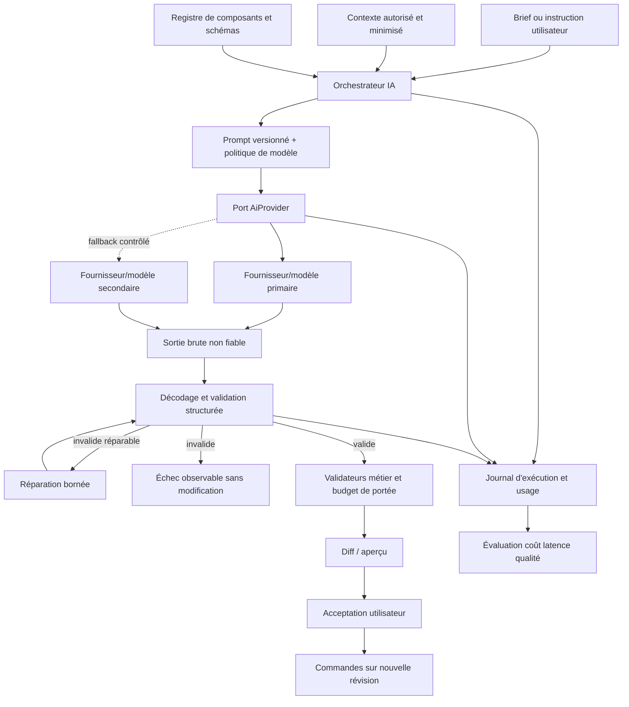

# 09 — Architecture de l'intelligence artificielle

## 1. Rôle et limites

L'IA est un moteur de proposition structurée : planifier, générer un document candidat, produire des patchs et assister la traduction. Elle n'est ni une autorité de validation, ni un moteur d'exécution, ni un accès privilégié aux données. Le schéma, le registre, les permissions et les contrôles déterministes restent la source de vérité.

Aucune capacité d'un modèle (structured outputs, appel d'outils, vision, comptage de tokens ou garantie JSON) n'est supposée sans vérification de la documentation du fournisseur et un test de contrat. Les adaptateurs comblent les différences sans prétendre les effacer.

## 2. Cas d'usage et niveaux d'autonomie

| Cas | Entrée | Sortie | Validation humaine/système |
|---|---|---|---|
| Brief → plan | Description, locale, secteur, objectifs | `SitePlan` avec pages, objectifs et capacités | Utilisateur peut modifier ; schéma du plan |
| Plan → site | Plan approuvé, thème, registre, exemples | Documents candidats, navigation, SEO initial | Validation complète, aperçu, acceptation |
| Texte/visuel | Contexte minimal | Textes ou suggestions d'assets | Droits, langue, contenu et revue |
| Modification ciblée | Instruction, sélection, révision, document réduit | Patch de commandes | Scope/révision/diff ; acceptation |
| Variante | Document et direction | Nouvelle branche/commande composite | Comparaison et undo |
| Traduction | Champs source et locale | Entrées de traduction brouillon | Revue ; fallback explicite |
| Contrôle qualité | Brief, plan, document, captures si validé | Problèmes classés | Ne remplace pas les tests déterministes |

L'IA ne publie pas, ne connecte pas de domaine, n'installe pas d'extension, ne change pas les rôles et ne déclenche pas de paiement. Ces opérations exigent des commandes hors du modèle.

## 3. Architecture logique

## 4. Ports fournisseurs et routage

Interface conceptuelle : `generateStructured(request)` et `estimateOrReportUsage(response)`, avec `provider`, `model`, `promptVersion`, schéma, locale, deadline, budget, identifiant d'idempotence et options de confidentialité. Les réponses normalisées comprennent statut, contenu brut protégé, usage déclaré, coût calculé avec grille datée, latence et métadonnées utiles.

Le routeur choisit selon tâche, qualité mesurée, locale, longueur de contexte, coût, latence, résidence et disponibilité. Les modèles ne sont pas codés en dur dans les prompts métier ; une configuration versionnée les associe à des capacités vérifiées.

### Comparaison des approches

| Approche | Avantages | Inconvénients | Recommandation |
|---|---|---|---|
| Monomodèle | Simplicité, prompts et évaluation réduits | Lock-in, disponibilité, compromis coût/qualité | Acceptable derrière le port pour premier pilote |
| Multi-modèles par tâche | Optimisation qualité/coût/latence | Matrice de tests et comportements variables | Cible après corpus et télémétrie |
| Orchestration multi-agents | Séparation plan/génération/critique | Coût, latence, erreurs composées, complexité | Seulement si gain mesuré sur pipeline simple |

**Décision provisoire :** pipeline explicite en étapes, un fournisseur primaire derrière abstraction, adaptateur secondaire testé avant lancement public si l'IA est indispensable au parcours. Pas d'agents autonomes libres.

## 5. Pipeline de génération fiable

1. **Analyse du brief :** extraction d'objectifs, audience, locales, contenus et modules demandés ; marquer les inconnues.
2. **Planification :** `SitePlan` borné ; distinguer capacités natives et modules manquants ; ne pas simuler une réservation ou un paiement.
3. **Approbation du plan :** l'utilisateur corrige pages et fonctionnalités ; le plan reçoit une révision.
4. **Sélection de composition :** templates/composants candidats filtrés par capacités et règles de compatibilité.
5. **Génération structurée :** petites unités (site thème/navigation, puis pages) afin de limiter les réparations globales.
6. **Validation :** JSON, schéma, registre, références, tailles, permissions, sécurité de contenu.
7. **Réparation bornée :** erreurs renvoyées sans contenu arbitraire ; nombre de tentatives et budget fixes.
8. **Résolution des ressources :** assets existants ou propositions ; stockage WOOBET et licence ; aucune URL temporaire publiée.
9. **Contrôles :** liens, navigation, locales, contrastes, règles responsive déterministes, rendu de test.
10. **Évaluation et classement :** fidélité au brief, variété perceptible, qualité et coût ; ne pas générer massivement sans nécessité.
11. **Présentation :** aperçu, hypothèses, avertissements et modules manquants.
12. **Acceptation/correction/annulation :** application comme commande composite sur le brouillon, jamais publication automatique.

## 6. Modification conversationnelle par patch

La requête inclut `instruction`, `pageId`, `selectedNodeIds`, `baseRevision`, `allowedOperations`, locale et budget. L'orchestrateur fournit uniquement le sous-arbre nécessaire et les définitions concernées, plus un résumé des tokens/thèmes.

Le modèle produit un patch déclaratif (pas JSON Patch arbitraire sur tout le document si la portée ne peut être prouvée). Le serveur vérifie :

- chaque chemin appartient à la sélection ou aux dépendances autorisées ;
- aucune augmentation de privilège/capacité ;
- la révision de base correspond toujours au moment de l'application ;
- les commandes sont valides et bornées en nombre/taille ;
- les textes non concernés et IDs restent inchangés selon l'instruction ;
- le diff est présenté avant application pour les changements structurants.

Une instruction globale (« change le thème global ») élargit explicitement la portée après confirmation. Un conflit de révision déclenche une nouvelle analyse, pas un écrasement.

## 7. Prompts et schémas

Un prompt versionné contient : identifiant, version, objectif, variables typées, instructions, exemples, schéma de sortie, modèle(s) autorisé(s), limites, politique de confidentialité, date et propriétaire. Les changements passent par revue et évaluation.

Les instructions utilisateur et contenus de pages sont des **données non fiables** délimitées ; le système ne leur permet pas de modifier les règles de sécurité. Les outils disponibles sont en allowlist, à arguments validés et permissions minimales. La prompt injection ne peut être « résolue » par une phrase de prompt : elle est limitée par l'architecture et l'absence de capacités dangereuses.

## 8. Reprise, cache et idempotence

Chaque génération possède états `queued`, `planning`, `generating`, `validating`, `render_check`, `ready`, `failed`, `cancelled`, `expired`. Les étapes et artefacts intermédiaires ont checksum et expiration. Un retry réutilise une étape valide si son entrée est identique.

Cache possible pour des suggestions publiques ou exemples strictement identiques ; il est généralement inapproprié pour des documents tenant contenant des données privées. Si utilisé : clé canonique, tenant ou portée publique, TTL, politique de confidentialité et invalidation sur version de prompt/modèle/schéma. Un cache ne doit pas mélanger des résultats entre clients.

Les appels fournisseurs ne sont pas supposés idempotents. Une reprise après timeout peut entraîner un double coût externe : l'usage est rapproché, les retries sont limités et l'idempotence provider est utilisée seulement si documentée.

## 9. Coûts et quotas

Budget à trois niveaux : par requête, par période/workspace et global plateforme. Le coût estimé réserve des crédits avant exécution ; le coût réel est calculé depuis usage et grille de prix datée ; l'écart est ajusté. Les prix ne sont pas codés en dur dans le dossier.

Mesures : tokens entrée/sortie et autres unités facturées, coût de réparation, nombre d'appels, latence par étape, taux de fallback, coût par génération acceptée (et non seulement produite). Les générations longues ont limites de concurrence et files séparées des tâches de publication.

## 10. Protection des données

- minimisation et classification avant envoi ; pas de secrets, tokens, soumissions de formulaires ou données d'autres tenants ;
- configuration de non-entraînement/rétention à vérifier contractuellement avec le fournisseur ; ne jamais la déduire d'un paramètre non vérifié ;
- chiffrement en transit, région et sous-traitants documentés ;
- contenus sensibles exclus ou traités seulement avec base légale et consentement approprié ;
- logs de prompts/réponses désactivés ou expurgés par défaut en production ; échantillonnage avec politique explicite ;
- suppression des artefacts intermédiaires selon TTL ;
- sorties de code non exécutées ; liens et médias contrôlés.

## 11. Évaluation

| Métrique | Définition |
|---|---|
| Validité structurelle | Documents acceptés par tous les validateurs / sorties reçues |
| Succès de génération | Générations `ready` sans intervention manuelle technique / demandes éligibles |
| Acceptation utilisateur | Résultats appliqués, avec taux d'annulation immédiat séparé |
| Fidélité au brief | Rubrique humaine + contrôles automatiques sur exigences explicites |
| Qualité visuelle | Revue en aveugle sur grille ; accessibilité et responsive séparés |
| Correction | Nombre de réparations système et commandes utilisateur avant acceptation |
| Latence | p50/p95 par étape et de bout en bout |
| Coût | Coût moyen/p95 par résultat valide et accepté |
| Responsive | Taux de corpus passant les contrôles à toutes les largeurs |
| Satisfaction | Note contextualisée, jamais unique indicateur |

### Jeu de référence

Au moins 100 briefs initiaux répartis entre secteurs, niveaux de détail, langues, longueurs, contenus manquants et demandes impossibles. Inclure restaurant multilingue, portfolio, blog, école sans prétendre LMS, boutique sans paiement, formulaire complexe, RTL, contenu long, instructions contradictoires et tentatives de prompt injection. Séparer jeu de développement, validation et test aveugle. Versionner briefs, résultats, versions de prompts/modèles/schémas et notes.

La non-régression compare distributions et cas critiques, pas uniquement une moyenne. Les modèles non déterministes exigent plusieurs exécutions échantillonnées ; aucun test ne garantit toutes les sorties.

## 12. Sécurité et abus

Rate limits par utilisateur/workspace/IP ; quotas et captcha adaptatif si nécessaire ; détection de contenus interdits selon politique ; limites de contexte ; interdiction d'exfiltration par URLs ; validation des appels d'outils ; audit des refus. Les modérations ne doivent pas empêcher arbitrairement des contenus légitimes ; une voie de revue existe.

## 13. Conditions de sortie

Le pilote IA est acceptable si le corpus démontre un taux de validité et une qualité définis après baseline, si les coûts sont plafonnés, si aucune sortie ne contourne le schéma, si l'utilisateur peut créer manuellement sans IA et si les résultats incomplets signalent leurs modules manquants. Les seuils chiffrés de lancement sont fixés après la baseline de phase 8, puis enregistrés comme gate mesuré.
