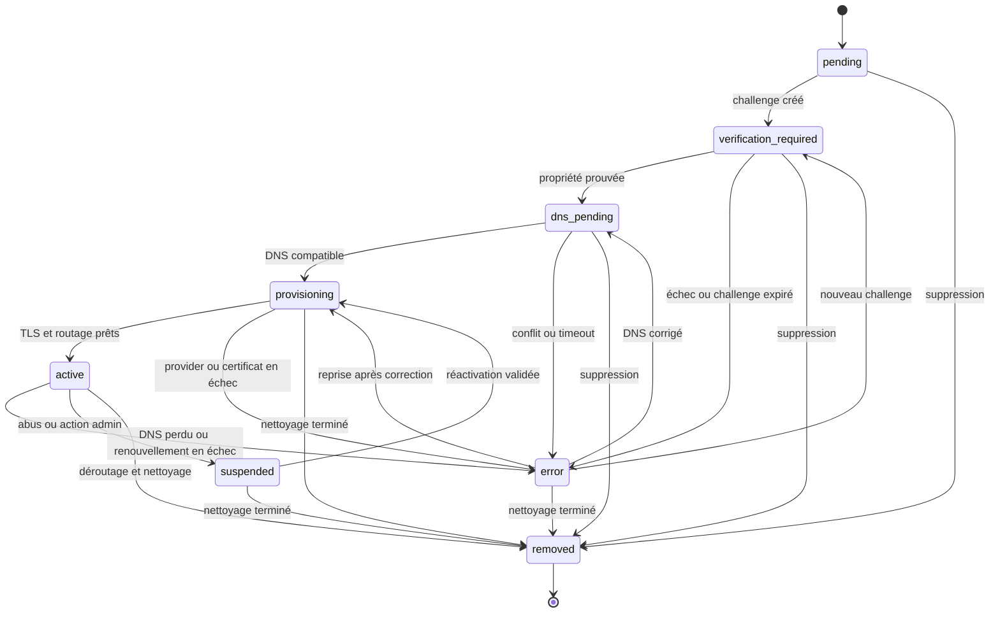

# 10 — URL, domaines, publication et SEO

## 1. Principe et non-acquisition des domaines

La cible fonctionnelle est `<slug>.woobet.com` ; `<slug>.woobet.app` est une variante possible. **Aucun de ces domaines n'est considéré comme possédé, disponible ou configuré.** Le code et la configuration utilisent `WOOBET_PUBLISH_BASE_DOMAIN`, `WOOBET_PREVIEW_BASE_DOMAIN` et des domaines de routage séparés. Les exemples n'impliquent aucune réservation.

Les domaines de gestion, d'aperçu, de publication, d'assets et d'éventuels scripts utilisateurs doivent être des origines distinctes. Les cookies du Studio sont limités à son hôte, sans attribut `Domain` partagé avec les sites publiés. L'ajout de la zone de publication à la Public Suffix List peut être étudié pour renforcer l'isolation entre sous-domaines, sans supposer une acceptation ni un délai.

## 2. Normalisation des URL et des hôtes

Un hôte est traité en minuscules, sans point final ni port, avec validation de longueur et conversion IDN en A-label punycode via une bibliothèque éprouvée. Le proxy doit fournir l'hôte original par un canal fiable ; les en-têtes de forwarding ne sont acceptés que depuis des proxies configurés.

Les chemins publics : UTF-8 normalisé, segments limités, pas de `..`, slash final selon politique unique, paramètres de tracking non inclus dans la clé canonique. Les slugs internes sont résolus par IDs de page afin de permettre les renommages avec redirections.

## 3. Sous-domaines WOOBET

### Règles de nommage proposées

- slug source Unicode transformé en ASCII par translittération contrôlée ou rejet avec proposition ; le résultat n'est pas supposé toujours fidèle ;
- 3 à 63 caractères ASCII pour le label, lettres minuscules, chiffres et tirets internes ; premier/dernier caractère alphanumérique ;
- normalisation avant vérification d'unicité ; contrainte unique sur la zone et le label canonique ;
- liste réservée : `www`, `api`, `app`, `studio`, `admin`, `mail`, `smtp`, `ftp`, `localhost`, `status`, `support`, `docs`, `assets`, `cdn`, `preview`, `internal`, noms de marques/protocoles et termes d'abus ; liste administrable et versionnée ;
- noms trompeurs (`login-woobet`, support officiel) et homoglyphes soumis à revue ;
- quotas et réservation temporaire contre squatting ; slug libéré seulement après grâce et contrôle des liens.

La réservation se fait par transaction avec contrainte unique. Un slug disponible à l'écran peut être pris avant confirmation ; l'API tranche.

### Cycle de vie

`available → reserved → attached → active → suspended → detached → cooldown → available`. Le changement de slug crée une nouvelle réservation, configure le routage et une redirection 301 depuis l'ancien si possible et autorisé, puis conserve l'ancien en cooldown. Un domaine suspendu ne redirige pas vers du contenu arbitraire ; il affiche une réponse contrôlée.

Prévention du détournement : ne jamais activer un enregistrement DNS pointant vers WOOBET sans ligne de domaine active et vérifiée ; vérifier périodiquement que les sous-domaines désaffectés ne laissent pas de CNAME vers une ressource tierce réappropriable ; supprimer les ressources cloud avant ou en même temps que les enregistrements selon runbook ; surveiller les certificate transparency logs si possible.

## 4. Domaines personnalisés

### Parcours

1. Saisie du domaine racine ou sous-domaine ; normalisation et contrôle de syntaxe.
2. Recherche de doublon global et conflit avec domaines réservés/internes.
3. Création `pending` et challenge de propriété aléatoire, non devinable et à usage défini.
4. Instructions TXT, par exemple `_woobet-challenge.<domaine>` avec valeur unique ; ne pas demander de modifier le MX.
5. Vérification asynchrone du TXT auprès de résolveurs et prise en compte des enregistrements multiples/TTL.
6. Une fois la propriété prouvée, état `dns_pending` et instructions de routage : CNAME pour sous-domaine ; pour apex, ALIAS/ANAME ou enregistrements A/AAAA fournis par la plateforme si effectivement supportés.
7. Contrôle du CNAME/A/AAAA, des conflits CNAME, DNSSEC si observable et redirections racine/www.
8. Provisionnement TLS, attente du certificat et test HTTPS.
9. Activation du routage seulement après propriété, DNS et TLS satisfaisants.
10. Surveillance du DNS, expiration du certificat et révocation/suspension.

Les enregistrements exacts et les noms d'hôtes cibles sont générés par la configuration du fournisseur retenu. Ce dossier n'invente pas d'adresse IP ni de cible CNAME.

### États synchrones et asynchrones

**Synchrones :** validation syntaxique, permission, doublon en base, création de l'intention et du challenge. **Asynchrones :** propagation/lecture DNS, vérification de propriété, validation de routage, émission et renouvellement TLS, déploiement edge, sondes et suppression chez le provider.

### Machine à états



`error` conserve un sous-code et la dernière transition saine ; il ne signifie pas forcément que le site est hors ligne. Un domaine actif dont le renouvellement échoue peut rester actif avec alerte jusqu'à l'échéance ; la politique évite les coupures automatiques prématurées. Les transitions sont compare-and-swap sur version d'état et journalisées.

### DNS racine, www et conflits

L'utilisateur choisit le domaine canonique entre apex et `www` après validation des deux si nécessaire. Le second redirige en 301 vers le canonique avec certificat valide. Un CNAME ne peut coexister avec certains enregistrements au même nom ; l'interface explique les conflits détectés sans prétendre diagnostiquer toutes les configurations. La propagation n'a pas de délai fixe garanti ; TTL, resolvers et caches sont affichés comme causes possibles.

Un domaine ne peut être attaché qu'à un projet actif à la fois. Une preuve ancienne ne suffit pas après transfert suspect ; la revérification périodique est recommandée. Les domaines malveillants, de phishing ou homoglyphes sont suspendus selon procédure d'abus.

### TLS

Comparer : offre managée de custom hostnames du CDN, service ACME interne avec challenges délégués, ou certificats importés (non recommandé). Le choix dépend coût par domaine, limites d'émission, API vérifiées, renouvellement et migration. Renouveler avec marge, alertes à J-30/J-14/J-7/J-1 selon disponibilité des dates, métrique `days_to_expiry`, et runbook. Respecter les rate limits ACME ; ne pas boucler les émissions.

## 5. Routage public

Table de résolution : `hostname_canonical → domainId → projectId → activePublicationId → status → canonicalHost`. Le résultat est mis en cache avec TTL court et invalidation par événement. Un hôte inconnu reçoit 404/421 contrôlée ; jamais le site par défaut d'un autre tenant.

Le routeur applique priorité : domaine exact personnalisé actif ; sous-domaine de publication actif ; redirections ; sinon erreur. Les domaines de prévisualisation ne sont pas routés par ce mécanisme public et exigent une autorisation.

## 6. Préparation d'une publication

### Prévol bloquant

- projet et pages valides, revisions cohérentes et aucune migration requise non exécutée ;
- composants/versions disponibles, profondeur et taille dans les limites ;
- assets publiés disponibles, checksums et droits d'usage connus ;
- chemins uniques, home et 404 définis, liens internes résolus ;
- locales et canoniques cohérentes ; redirections sans boucle ;
- capacités installées, secrets uniquement référencés côté serveur ;
- pas de champs internes dans la projection publique ;
- quotas et statut du workspace autorisant la publication ;
- tests de rendu du manifeste candidat.

Les avertissements (description absente, contraste à revoir selon outil) sont présentés avec politique bloquante explicite.

### Bundle immutable

```text
publications/{projectId}/{publicationId}/
  manifest.json
  pages/{locale}/{pageId}.json
  themes/{themeVersion}.json
  assets/...                  # références ou copies immuables
  redirects.json
  sitemaps/...
  checksums.json
```

Le manifeste inclut `schemaVersion`, `rendererCompatibility`, versions de composants, routes, locales, domaine canonique logique, dates, `sourceRevision`, checksums et taille. L'URI de stockage n'est pas une URL signée temporaire.

## 7. Activation atomique et rollback

1. Une transaction crée la publication `preparing` avec intention et clé d'idempotence.
2. Le worker lit un snapshot cohérent ; les changements ultérieurs du brouillon n'altèrent pas la publication.
3. Les artefacts sont écrits sous un nouveau préfixe ; aucun objet de l'ancienne version n'est écrasé.
4. Après checksums et rendu de test, la publication devient `ready`.
5. Une transaction vérifie que le projet n'a pas une activation plus récente incompatible, met à jour `active_publication_id`, insère l'audit/outbox et marque l'activation.
6. Les caches utilisent le nouvel ID ; l'ancien reste lisible.
7. Les sondes vérifient routes critiques et assets. En cas d'échec attribuable avant stabilisation, une nouvelle activation restaure le pointeur précédent selon politique anti-flapping.
8. L'utilisateur reçoit le résultat et les erreurs actionnables.

**Aucune suppression d'ancien bundle n'est synchrone avec l'activation.** Le rollback crée un événement/nouvelle activation vers un bundle existant ; il ne change pas le brouillon. La restauration du brouillon depuis une publication est une opération distincte.

## 8. Versions et rétention

| Type | Création | Mutable ? | Rétention |
|---|---|---|---|
| Brouillon courant | Autosave | Oui, avec révision | Tant que projet actif + corbeille |
| Checkpoint | Manuel, avant IA/template, périodique | Non | Selon offre et politique ; certains protégés |
| Version publiée | Chaque publication | Non | Au moins la fenêtre de rollback de l'offre |
| Activation/rollback | Bascule de pointeur | Événement immuable | Audit long selon politique |

La comparaison porte sur structure, contenu, thème, routes, assets et métadonnées. Les suppressions définitives respectent références, obligations légales et délai des sauvegardes.

## 9. SEO technique

- une canonique absolue par page/locale, sur le domaine canonique actif ; jamais sur le domaine de prévisualisation ;
- `sitemap.xml` et index si nécessaire, uniquement pages publiques indexables et canoniques ; URLs sans paramètres de session ;
- `robots.txt` par site, sans croire qu'il protège un contenu privé ;
- balises titre/description/Open Graph/Twitter selon champs et assets ;
- hreflang réciproque et `x-default` si configuré ; canonique auto-référente par locale sauf règle explicite ;
- 301 pour migrations permanentes, 302 pour temporaires ; détection de chaînes/boucles et limite de hops ;
- 404/410 cohérentes, sans soft-404 systématique ;
- JSON-LD généré par composants validés ; pas de JSON arbitraire injecté ;
- CWV mesurés, aucun classement garanti ;
- preview/staging : authentification + `noindex` + en-têtes `X-Robots-Tag`, sans compter sur robots seul.

Changement de slug/domaine : carte d'URLs, redirections une-à-une, mise à jour des liens internes, canoniques, sitemap et surveillance des 404. Les redirections sont limitées en nombre et auditées.

## 10. Tests obligatoires

Deux projets tentent le même slug/domaine ; changement pendant publication ; DNS lent puis corrigé ; TXT multiple ; CNAME conflictuel ; IDN/homoglyphe ; certificat en échec/expiré ; domaine supprimé puis réattribué ; `Host` malveillant ; preview sans session ; rollback pendant trafic ; kill worker avant/après écriture objet et avant/après activation ; cache ancien/nouveau ; boucles de redirection ; sitemap multilingue ; domaine suspendu. Aucun test ne doit émettre de vrais certificats ou modifier un DNS public sans environnement et quota dédiés.
