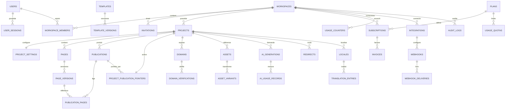

# 12 — Schéma de base de données

## 1. Principes du modèle

PostgreSQL est la source de vérité des identités, tenants, brouillons, états, pointeurs et usages. Le stockage objet contient les binaires, bundles de publication et artefacts volumineux. Redis contient cache et coordination, jamais la seule preuve d'un état métier.

Le modèle physique proposé ajoute plusieurs tables à la liste initiale afin d'éviter des pointeurs sans intégrité, de tracer les effets externes et de séparer quotas et compteurs. Les noms sont en snake_case ; les API exposent des DTO, pas les lignes ORM.

## 2. Conventions communes

| Convention | Règle |
|---|---|
| Identifiants | `uuid` ; UUIDv7 recommandé après validation de la bibliothèque et du tri. Génération serveur ou DB maîtrisée |
| Temps | `timestamptz`, UTC ; `created_at`, `updated_at` lorsque mutable ; jamais de timestamp local sans fuseau |
| Tenant | `workspace_id uuid NOT NULL` sur toute table tenant, sauf tables globales et identités utilisateur |
| Révisions | `bigint` positive ; optimistic locking ; pas de compteur supposé global |
| JSON | `jsonb` avec schéma applicatif versionné ; pas de données binaires ; taille et profondeur bornées |
| Argent | `bigint` en unités mineures + `currency char(3)` ; aucun float |
| Suppression | `deleted_at` pour corbeille lorsque nécessaire ; purge par tâche ; les événements immuables n'ont pas `updated_at` |
| Données sensibles | Classification `public`, `internal`, `personal`, `secret_ref` ; les secrets eux-mêmes restent dans le coffre |
| Clés étrangères tenant | Clés composites `(workspace_id, id)` et FK composites pour les relations critiques afin d'empêcher les liens croisés |

Pour alléger les dictionnaires, `PK(id)` signifie clé primaire UUID ; `UQ` contrainte unique ; `IDX` index ; `FK` clé étrangère. Les colonnes communes `id`, `workspace_id`, `created_at`, `updated_at` ne sont répétées que lorsque leur sémantique demande une précision. Chaque table tenant possède `UQ(workspace_id,id)` lorsqu'elle est cible d'une FK composite.

## 3. Diagramme ERD principal

Les tables d'outbox, formulaires, collections et extensions sont décrites ci-dessous ; elles sont omises du diagramme pour préserver sa lisibilité, non parce qu'elles sont sans relation.

## 4. Identité et tenancy

### `users`

- **Rôle :** identité humaine globale, indépendante d'un workspace.
- **Colonnes :** `id uuid PK`, `email citext NOT NULL`, `email_normalized text NOT NULL`, `email_verified_at timestamptz`, `password_hash text`, `display_name text NOT NULL`, `avatar_asset_id uuid`, `ui_locale text NOT NULL`, `timezone text NOT NULL`, `status text NOT NULL`, `last_login_at timestamptz`, `created_at`, `updated_at`, `deleted_at`.
- **Contraintes/index :** `UQ(email_normalized)` ; `IDX(lower(display_name))` seulement si besoin ; `status IN (pending,active,suspended,deleted)` ; email BCP de longueur raisonnable. `password_hash` nul pour compte uniquement fédéré.
- **Relations/suppression :** un utilisateur a sessions, identités et memberships. Suppression = anonymisation après traitement des workspaces possédés ; FK personnelles selon politique. Ne pas supprimer en cascade les audits légaux.
- **Rétention/sensibilité/migration :** données personnelles ; purge/anonymisation après délai légal. Toute modification d'email normalisé exige migration de collision et revérification.

### `user_identities`

- **Rôle :** comptes OAuth/OIDC liés.
- **Colonnes :** `id`, `user_id FK users ON DELETE CASCADE`, `provider text`, `provider_subject text`, `email_at_provider text`, `profile jsonb`, `linked_at`, `last_used_at`.
- **Contraintes/index :** `UQ(provider,provider_subject)` ; `IDX(user_id)` ; profil expurgé.
- **Suppression/rétention/sensibilité :** liaison supprimable par utilisateur si une autre méthode de connexion reste ; données personnelles ; pas de jeton OAuth durable sans table/coffre dédié.

### `user_sessions`

- **Rôle :** sessions opaques révocables.
- **Colonnes :** `id`, `user_id FK`, `token_hash bytea UNIQUE`, `created_at`, `expires_at`, `last_seen_at`, `revoked_at`, `ip_prefix inet`, `user_agent_hash bytea`, `auth_level text`, `recovery_required boolean`.
- **Index/règles :** `IDX(user_id,revoked_at,expires_at)`, `IDX(expires_at)` pour purge ; jeton brut jamais stocké/journalisé.
- **Suppression/rétention :** cascade à la suppression définitive de l'utilisateur ; purge après expiration + fenêtre d'audit ; sensibilité élevée.

### `workspaces`

- **Rôle :** frontière de tenant et de facturation.
- **Colonnes :** `id`, `name`, `slug text`, `owner_id FK users`, `status text`, `default_locale`, `timezone`, `data_region text`, `created_at`, `updated_at`, `deleted_at`.
- **Contraintes/index :** `UQ(slug)` si slug global, sinon identifiant interne seulement ; `IDX(owner_id)` ; statut contrôlé.
- **Suppression :** transfert de propriété avant suppression du dernier owner ; soft delete, grâce, export, puis purge selon dépendances. Pas de cascade physique immédiate.
- **Sensibilité/migration :** interne/personnel ; `data_region` informative tant que la résidence n'est pas réellement provisionnée.

### `workspace_members`

- **Rôle :** appartenance et rôle de base.
- **Colonnes :** `workspace_id FK`, `user_id FK`, `role text`, `status text`, `invited_by uuid`, `joined_at`, `created_at`, `updated_at`, PK composite `(workspace_id,user_id)`.
- **Contraintes/index :** `IDX(user_id,status)` ; rôle `owner,admin,editor,contributor,viewer` ; contrainte/transaction empêchant zéro owner actif.
- **Suppression/rétention :** retrait logique ou suppression avec audit ; dernier owner refusé ; données personnelles. Rôles personnalisés nécessiteront tables role/permission plutôt qu'une chaîne libre.

### `invitations`

- **Rôle :** invitations à rejoindre un workspace.
- **Colonnes :** `id`, `workspace_id FK`, `email_normalized`, `role`, `token_hash`, `invited_by`, `expires_at`, `accepted_at`, `accepted_by`, `revoked_at`, `created_at`.
- **Contraintes/index :** `UQ(token_hash)`, `IDX(workspace_id,email_normalized,accepted_at)`, unicité partielle des invitations actives.
- **Suppression/rétention :** révocation/expiration ; purge du token et email après délai ; audit conservé sous forme minimisée.

## 5. Projets, documents et versions

### `projects`

- **Rôle :** un site ou expérience numérique.
- **Colonnes :** `id`, `workspace_id FK`, `name`, `slug`, `status`, `created_by`, `template_origin_id`, `draft_revision bigint DEFAULT 0`, `active_publication_id` **non matérialisé** (voir pointer table), `published_at`, `archived_at`, `created_at`, `updated_at`, `deleted_at`.
- **Contraintes/index :** `UQ(workspace_id,id)`, `UQ(workspace_id,slug)` avec slug non global, `IDX(workspace_id,status,updated_at DESC)`, FK créateur sans cascade.
- **Suppression/rétention :** corbeille puis purge après export et retrait des domaines ; publications selon rétention. Le pointeur actif est dans une table séparée pour éviter une FK circulaire.

### `project_settings`

- **Rôle :** configuration de brouillon du projet.
- **Colonnes :** `workspace_id`, `project_id`, `theme_document jsonb`, `navigation_document jsonb`, `seo_defaults jsonb`, `feature_settings jsonb`, `revision bigint`, `updated_at`, PK `(workspace_id,project_id)`, FK composite vers projects.
- **Index/règles :** schéma de chaque JSON ; taille bornée ; revision optimiste ; aucun secret.
- **Suppression/rétention :** cascade avec projet après grâce ; les snapshots publiés sont copiés dans le bundle.

### `pages`

- **Rôle :** identité logique et brouillon courant d'une page.
- **Colonnes :** `id`, `workspace_id`, `project_id`, `kind text`, `draft_document jsonb`, `draft_schema_version text`, `draft_revision bigint`, `status text`, `created_by`, `updated_by`, `created_at`, `updated_at`, `deleted_at`.
- **Contraintes/index :** `UQ(workspace_id,id)`, `UQ(workspace_id,project_id,id)` implicite pour FK ; `IDX(workspace_id,project_id,status)` ; `draft_revision>=0` ; taille validée.
- **Relations/suppression :** FK `(workspace_id,project_id)` → projects ; versions en cascade seulement à purge. Les chemins sont dans le document et validés au niveau projet ; index d'unicité de publication via `publication_pages`.
- **Rétention/sensibilité/migration :** brouillon potentiellement personnel/confidentiel ; migration JSON jamais en place sur versions publiées.

### `page_versions`

- **Rôle :** checkpoints immuables et sources de publication.
- **Colonnes :** `id`, `workspace_id`, `project_id`, `page_id`, `number bigint`, `kind text (manual,autosave_checkpoint,pre_ai,pre_template,publish,restore)`, `schema_version`, `document jsonb`, `document_uri text`, `checksum bytea`, `created_by`, `created_at`, `source_revision`, `comment text`.
- **Contraintes/index :** `UQ(workspace_id,page_id,number)`, `IDX(workspace_id,project_id,created_at DESC)`, exactement un de `document`/`document_uri` selon politique de taille, checksum obligatoire.
- **Suppression/rétention :** immuable ; pas d'update ; rétention par plan et protection des versions référencées. Les gros documents partent en objet ; PostgreSQL ne stocke pas les binaires.

### `publications`

- **Rôle :** intention, construction et état d'une version site complète.
- **Colonnes :** `id`, `workspace_id`, `project_id`, `number bigint`, `state text`, `source_revision`, `manifest_uri`, `manifest_checksum`, `renderer_compatibility`, `requested_by`, `idempotency_key`, `error_code`, `error_details jsonb`, `created_at`, `ready_at`, `activated_at`, `completed_at`, `expires_at`.
- **Contraintes/index :** `UQ(workspace_id,project_id,number)`, `UQ(project_id,idempotency_key)`, `IDX(workspace_id,project_id,state,created_at)` ; états `preparing,validating,building,ready,activating,active,superseded,failed,cancelled` ; une seule activation courante via pointer, pas un flag seul.
- **Suppression/rétention :** `RESTRICT` tant que pointée ; purge du bundle seulement après déréférencement et grâce. `error_details` expurgé.

### `publication_pages`

- **Rôle :** routes et pages figées dans une publication.
- **Colonnes :** `workspace_id`, `project_id`, `publication_id`, `page_id`, `page_version_id`, `locale_id`, `path text`, `canonical_path`, `robots`, `document_uri`, `checksum`, PK `(publication_id,locale_id,path)`.
- **FK/index :** composites vers publication, page et version ; `IDX(project_id,page_id)` ; `UQ(publication_id,page_id,locale_id)`.
- **Règle :** une `page_version` appartient au même projet et workspace ; le rendu de test valide aussi les routes. Suppression en cascade avec publication seulement à purge.

### `project_publication_pointers`

- **Rôle :** pointeur atomique de la publication actuellement servie.
- **Colonnes :** `workspace_id`, `project_id`, `publication_id`, `activated_at`, `activated_by`, `activation_kind (publish,rollback,recovery)`, `previous_publication_id`, `revision bigint`, PK `(workspace_id,project_id)`.
- **FK/règles :** FK composite `(workspace_id,project_id,publication_id)` vers une clé unique équivalente de publications ; `previous_publication_id` contrôlé ; mise à jour dans la transaction d'activation.
- **Suppression/rétention :** cascade avec projet ; publication active `RESTRICT`. Chaque changement ajoute un audit ; les anciennes lignes de publications restent.

## 6. Domaines et routage

### `domains`

- **Rôle :** sous-domaines de plateforme et domaines personnalisés.
- **Colonnes :** `id`, `workspace_id`, `project_id`, `kind text`, `hostname text`, `ascii_hostname text`, `zone text`, `state text`, `state_version bigint`, `is_canonical boolean`, `canonical_target_id`, `verification_method`, `dns_expected jsonb`, `dns_observed jsonb`, `certificate_id text`, `certificate_expires_at`, `last_checked_at`, `last_error_code`, `suspended_reason`, `created_at`, `updated_at`, `removed_at`.
- **Contraintes/index :** `UQ(ascii_hostname)` global sur domaines non purgés ; `IDX(project_id,state)`, `IDX(state,last_checked_at)`, unicité partielle d'un canonique par projet ; `hostname` en minuscules ; états du document 10.
- **Suppression/rétention/sensibilité :** retrait du routage/TLS avant purge ; cooldown et audit. Les données DNS sont internes ; aucune clé privée TLS dans PostgreSQL.

### `domain_verifications`

- **Rôle :** challenges et tentatives de preuve.
- **Colonnes :** `id`, `workspace_id`, `domain_id`, `method text`, `token_hash`, `record_name`, `record_value_reference`, `status`, `attempt_count`, `not_before`, `expires_at`, `verified_at`, `last_error`, `created_at`.
- **Contraintes/index :** `IDX(domain_id,status,expires_at)`, unicité partielle d'un challenge actif ; token brut seulement affiché selon besoin et jamais logué.
- **Rétention :** purge des challenges expirés après audit ; la preuve de vérification reste minimisée.

## 7. Médias

### `asset_folders`

`id`, `workspace_id`, `project_id`, `parent_id`, `name`, `path_materialized` optionnel, timestamps ; FK parent composite, contrainte anti-cycle applicative ; `UQ(workspace_id,project_id,parent_id,name)` avec gestion du parent nul ; index projet/parent. Cascade interdite si enfants ; suppression après déplacement.

### `assets`

- **Rôle :** métadonnées d'un original, jamais son binaire.
- **Colonnes :** `id`, `workspace_id`, `project_id`, `folder_id`, `storage_key`, `original_filename`, `media_type`, `detected_type`, `byte_size bigint`, `width`, `height`, `duration_ms`, `checksum_sha256 bytea`, `status text`, `visibility text`, `alt_texts jsonb`, `focal_point jsonb`, `metadata jsonb`, `license_text`, `source text`, `ai_generation_id`, `scan_status`, `uploaded_by`, `created_at`, `updated_at`, `deleted_at`.
- **Contraintes/index :** `UQ(workspace_id,storage_key)`, `IDX(workspace_id,project_id,status)`, `IDX(workspace_id,checksum_sha256)` pour déduplication contrôlée, `IDX(folder_id)` ; tailles positives ; statuts upload/scan/ready/failed/deleted.
- **Suppression/rétention :** suppression bloquée si référencée par une publication tant qu'elle doit être servie ; copie immutable de publication ou compteur de références ; corbeille puis purge objet après grâce. Métadonnées personnelles possibles ; EXIF expurgé selon politique.

### `asset_variants`

`id`, `workspace_id`, `asset_id`, `spec_hash`, `format`, `width`, `height`, `quality`, `storage_key`, `byte_size`, `checksum`, `status`, `created_at` ; `UQ(asset_id,spec_hash)`, `IDX(asset_id,status)` ; suppression avec purge d'objet après références ; recréable depuis l'original si sain.

### `asset_tags`

`workspace_id`, `asset_id`, `tag_normalized`, `display_tag`, PK `(asset_id,tag_normalized)`, FK composite ; index `(workspace_id,tag_normalized,asset_id)` ; suppression en cascade avec asset. Les tags ne doivent pas contenir de données sensibles.

## 8. Templates et composants

### `templates`

`id`, `workspace_id NULL` (nul = système), `slug`, `name`, `kind`, `visibility`, `author_id`, `license`, `status`, timestamps ; `UQ(workspace_id,slug)` et unicité système gérée par index `COALESCE` ou colonne de scope ; index visibilité/kind. Suppression seulement si aucune version utilisée n'exige rétention ; licence obligatoire.

### `template_versions`

`id`, `workspace_id NULL`, `template_id`, `version`, `schema_range`, `manifest jsonb`, `document_uri`, `preview_asset_id`, `dependency_manifest jsonb`, `checksum`, `published_at`, `created_at`, `deprecated_at` ; `UQ(template_id,version)` ; immuable après publication ; dépendances et licences expurgées de secrets. Suppression restreinte si instanciée selon politique d'origine.

### `component_definitions`

`id`, `workspace_id NULL`, `component_key`, `version`, `kind`, `props_schema jsonb`, `defaults jsonb`, `variants jsonb`, `constraints jsonb`, `capabilities text[]`, `migration_key`, `status`, `created_at`, `deprecated_at` ; `UQ(workspace_id,component_key,version)` ; pas de code exécutable ; le mapping renderer est dans le bundle applicatif signé/versionné. Les définitions système sont lisibles par tous sans exposer les définitions privées.

## 9. IA

### `ai_generations`

- **Colonnes :** `id`, `workspace_id`, `project_id`, `requested_by`, `kind`, `state`, `provider_policy_version`, `prompt_version`, `model_route jsonb`, `input_reference`, `input_checksum`, `base_revision`, `output_reference`, `validation_report jsonb`, `credits_reserved`, `credits_final`, `idempotency_key`, `error_code`, `created_at`, `started_at`, `completed_at`, `expires_at`.
- **Contraintes/index :** `UQ(workspace_id,idempotency_key)`, `IDX(workspace_id,project_id,created_at DESC)`, `IDX(state,created_at)` ; références objet plutôt que prompts complets dans la ligne si volumineux.
- **Rétention/sensibilité :** prompts et sorties potentiellement personnels ; TTL court des artefacts intermédiaires ; rapports expurgés ; suppression ne supprime pas les usages financiers nécessaires.

### `ai_usage_records`

`id`, `workspace_id`, `generation_id`, `provider`, `model`, `call_index`, `input_units`, `output_units`, `other_usage jsonb`, `price_table_version`, `cost_estimate_minor`, `cost_actual_minor`, `currency`, `latency_ms`, `status`, `provider_request_id`, `created_at` ; `UQ(generation_id,call_index)` lorsque déterministe, index coût/workspace/date ; immuable sauf rapprochement de coût ; ne contient pas de prompt.

## 10. Facturation, droits et usages

### `plans`

`id`, `code`, `version`, `name_key`, `status`, `billing_interval`, `trial_days`, `entitlements jsonb`, `provider_price_mappings jsonb`, `effective_from`, `effective_to`, timestamps ; `UQ(code,version)` ; prix réel externalisé et daté, jamais inféré du nom ; immuable après usages actifs.

### `subscriptions`

`id`, `workspace_id`, `plan_id`, `provider`, `provider_customer_ref`, `provider_subscription_ref`, `status`, `current_period_start`, `current_period_end`, `trial_ends_at`, `cancel_at_period_end`, `cancelled_at`, `grace_ends_at`, `last_provider_event_at`, timestamps ; `UQ(provider,provider_subscription_ref)`, index workspace/statut ; une seule souscription principale active par workspace via index partiel. Suppression limitée par obligations financières ; références sensibles.

### `usage_quotas`

`id`, `plan_id`, `metric_key`, `limit_value bigint NULL`, `period text`, `overage_policy text`, `warning_thresholds jsonb`, `technical_hard_cap bigint`, `created_at` ; `UQ(plan_id,metric_key)` ; `NULL` ne signifie pas illimité sans hard cap de sécurité ; suppression restreinte si plan utilisé.

### `entitlement_overrides`

`id`, `workspace_id`, `metric_or_feature`, `value jsonb`, `reason`, `approved_by`, `starts_at`, `ends_at`, timestamps ; index workspace/expiration ; audit obligatoire ; expiration automatique, pas d'override permanent sans revue.

### `usage_counters`

`workspace_id`, `metric_key`, `period_start`, `period_end`, `value_numeric numeric`, `reserved_numeric`, `source`, `last_event_id`, `updated_at`, PK `(workspace_id,metric_key,period_start,source)` ; index période ; mises à jour atomiques ; compteurs techniques distincts de la source de facturation finale si le provider mesure le trafic. Rétention agrégée longue, événements détaillés courte.

### `invoices`

`id`, `workspace_id`, `subscription_id`, `provider`, `provider_invoice_ref`, `number`, `status`, `currency`, `subtotal_minor`, `tax_minor`, `total_minor`, `issued_at`, `due_at`, `paid_at`, `refunded_at`, `document_uri`, `raw_event_reference`, timestamps ; `UQ(provider,provider_invoice_ref)`, index workspace/date ; rétention selon obligations comptables ; accès restreint ; aucune donnée complète de carte.

## 11. Intégrations, webhooks et extensions

### `integrations`

`id`, `workspace_id`, `project_id NULL`, `kind`, `provider`, `status`, `config_public jsonb`, `secret_ref text`, `scopes text[]`, `installed_by`, `last_checked_at`, timestamps ; `UQ(workspace_id,project_id,kind,provider)` selon cardinalité ; aucun secret en clair ; suppression révoque d'abord les credentials et webhooks.

### `webhooks`

`id`, `workspace_id`, `integration_id`, `target_url`, `signing_secret_ref`, `event_types text[]`, `status`, `api_version`, `retry_policy jsonb`, `created_at`, `updated_at`, `disabled_at` ; index workspace/statut ; URL revalidée SSRF à chaque livraison ; secret en coffre.

### `webhook_deliveries`

`id`, `workspace_id`, `webhook_id`, `event_id`, `payload_reference`, `attempt_count`, `next_attempt_at`, `last_status_code`, `last_error`, `delivered_at`, `created_at` ; `UQ(webhook_id,event_id)` ; index file `(status,next_attempt_at)` ; payload avec rétention courte et expurgation ; DLQ = état + alerte, pas suppression.

### `extensions`

`id`, `publisher_workspace_id NULL`, `extension_key`, `version`, `manifest jsonb`, `package_uri`, `checksum`, `permissions text[]`, `api_range`, `status`, `created_at` ; unique éditeur/key/version ; package signé et analysé ; suppression restreinte si installé.

### `extension_installations`

`id`, `workspace_id`, `project_id`, `extension_id`, `status`, `config_public jsonb`, `secret_ref`, `granted_permissions text[]`, `installed_by`, timestamps ; `UQ(project_id,extension_id)` ; les permissions effectives sont l'intersection demandée/accordée/plan ; désactivation avant purge.

## 12. Contenus dynamiques et formulaires (fondations)

### `data_collections`

`id`, `workspace_id`, `project_id`, `key`, `name`, `schema jsonb`, `schema_version`, `status`, `revision`, timestamps ; `UQ(project_id,key)` ; champs/requêtes limités ; suppression seulement après migration des records et références.

### `data_records`

`id`, `workspace_id`, `project_id`, `collection_id`, `slug`, `status`, `data jsonb`, `revision`, `published_at`, timestamps ; `UQ(collection_id,slug)` avec locales selon évolution ; index `(collection_id,status)` et index JSON seulement après mesure ; validation serveur ; purge/export tenant. Les relations critiques utiliseront des tables de liaison typées plutôt que des IDs cachés non contraints lorsque le module le nécessite.

### `form_submissions`

`id`, `workspace_id`, `project_id`, `form_key`, `submission_uuid`, `payload_ciphertext bytea` ou référence chiffrée, `payload_metadata jsonb`, `consent jsonb`, `source_domain`, `spam_status`, `created_at`, `expires_at`, `deleted_at` ; `UQ(project_id,form_key,submission_uuid)` pour idempotence ; index expiration ; accès restreint, jamais de payload dans logs ; export/suppression et chiffrement applicatif à clés gérées.

## 13. Locales, traductions et redirections

### `locales`

`id`, `workspace_id`, `project_id`, `code text`, `is_default boolean`, `fallback_locale_id`, `enabled boolean`, `direction text`, `created_at`, `updated_at` ; `UQ(project_id,code)`, unicité partielle d'une locale par défaut ; codes BCP 47 validés, direction dérivée mais surcharge contrôlée ; suppression bloquée si traductions/publications sans migration.

### `translation_entries`

`id`, `workspace_id`, `project_id`, `locale_id`, `namespace`, `owner_type`, `owner_id uuid`, `field_path`, `value jsonb`, `status`, `source_hash`, `translated_by`, `ai_generation_id`, `revision`, timestamps ; `UQ(locale_id,namespace,owner_type,owner_id,field_path)` ; index owner. **Arbitrage :** `owner_type/owner_id` polymorphe n'offre pas de FK SQL générique ; V1 restreint `owner_type` à des types contrôlés et des jobs d'intégrité détectent les orphelins. Si les collections deviennent critiques, des tables de traduction typées les remplacent.

### `redirects`

`id`, `workspace_id`, `project_id`, `source_path`, `target text`, `status_code integer`, `locale_code`, `enabled`, `starts_at`, `ends_at`, `created_by`, timestamps ; `UQ(project_id,locale_code,source_path)` ; seulement 301/302 au socle ; cible externe validée ; boucles détectées au prévol ; index de routage ; audit et suppression différée.

## 14. Audit, outbox et idempotence

### `audit_logs`

`id`, `workspace_id`, `actor_user_id`, `actor_service`, `action`, `resource_type`, `resource_id`, `request_id`, `trace_id`, `ip_prefix`, `metadata jsonb`, `previous_hash`, `event_hash`, `created_at` ; index `(workspace_id,created_at desc)`, `(resource_type,resource_id,created_at)`, partitionnement mensuel lorsque volume ; append-only pour rôle runtime ; metadata sans secrets/contenu. Rétention selon conformité ; chaîne de hash complète la protection mais ne remplace pas un stockage WORM si exigé.

### `outbox_events`

`id`, `workspace_id`, `aggregate_type`, `aggregate_id`, `event_type`, `event_version`, `payload jsonb`, `correlation_id`, `occurred_at`, `published_at`, `attempt_count`, `last_error` ; `UQ(id)`, index partiel `(occurred_at) WHERE published_at IS NULL` ; insertion dans transaction métier ; purge après publication + délai ; payload minimal.

### `idempotency_keys`

`id`, `workspace_id`, `actor_id`, `scope`, `key_hash`, `request_hash`, `resource_type`, `resource_id`, `response_status`, `response_reference`, `locked_until`, `created_at`, `expires_at` ; `UQ(workspace_id,scope,key_hash)` ; même clé avec request hash différent = 409 ; purge après fenêtre maximale de retry ; ne stocke pas de payload sensible.

## 15. Indexation, partitionnement et performance

Les index ci-dessus sont un point de départ, pas une autorisation à tous les créer sans mesure. Chaque requête fréquente est testée avec volumétrie. Les index composites commencent par les colonnes d'égalité tenant et respectent tri/filtrage. Les index GIN JSONB sont évités sauf requêtes récurrentes prouvées. `updated_at` n'est pas un curseur unique ; utiliser `(updated_at,id)` ou un curseur opaque signé/codé.

Partitions candidates : audit, usage détaillé, ai_usage et deliveries. Ne pas partitionner prématurément les petites tables. Les purges par partition sont préférables aux mass deletes ; les suppressions doivent préserver les contraintes et obligations.

## 16. Isolation RLS et transactions

Chaque cas d'usage ouvre une transaction, vérifie le membership/RBAC puis exécute `SET LOCAL app.workspace_id = '<uuid validé>'` avec un paramètre sûr et un rôle runtime non propriétaire des tables, sans `BYPASSRLS`. Les politiques exigent `workspace_id = current_setting(...)::uuid`. Le membership reste vérifié par l'application et, pour les chemins critiques, par une fonction DB sécurisée. RLS seul ne choisit pas le workspace : il empêche surtout les filtres manquants et accès croisés.

Le pool ne réutilise jamais un contexte `SET` de session ; seul `SET LOCAL` dans une transaction, ou reset vérifié. Les tâches sans tenant (migration, purge globale) utilisent des rôles séparés et ne partagent pas les credentials runtime.

Exemple de transaction d'activation : verrouiller la ligne pointer/projet ; vérifier publication `ready`, même workspace/projet et checksum ; lire ancien pointeur ; upsert du nouveau ; marquer ancienne `superseded` et nouvelle `active` selon machine d'état ; écrire audit + outbox ; commit. Le worker ne modifie pas les artefacts après ce commit.

## 17. Exemple de migration

Le fichier `examples/0001_core.sql` illustre les tables de base, contraintes composites et RLS. Il est **non exécuté dans cette mission** et doit être revu/adapté à l'outil de migration choisi. Principe de déploiement :

1. expansion additive compatible avec ancien et nouveau code ;
2. déploiement du code capable de lire les deux formes ;
3. backfill borné, resumable et contrôlé ;
4. validation des compteurs/contraintes ;
5. bascule ;
6. contraction dans une release ultérieure après fenêtre de rollback.

Les migrations de JSON de pages suivent le pipeline du document 08 et ne sont pas exécutées avec un `UPDATE` massif sans checkpoint.

## 18. Rétention et suppression globale

Une demande de suppression de workspace produit un plan : suspension des écritures, export éventuel, retrait domaines/routage, révocation intégrations/sessions, purge objets après grâce, anonymisation des données personnelles, conservation minimale des factures/audits exigés, expiration des sauvegardes. Le rapport indique ce qui est supprimé immédiatement et ce qui expire. Aucun `ON DELETE CASCADE` global ne doit supprimer accidentellement des preuves financières ou des bundles encore servis.

## 19. Inconnues à trancher en phase 0/1

Choix ORM et outil de migration ; UUIDv7 et support ; stratégie exacte de RLS avec pool ; stockage inline/objet des checkpoints selon taille ; partitionnement différé ; modèle organisation/agence au-dessus des workspaces si nécessaire ; tables de rôles personnalisés ; résidence et chiffrement applicatif ; analytics externe. Ces décisions n'empêchent pas de valider les invariants et contraintes listés.
