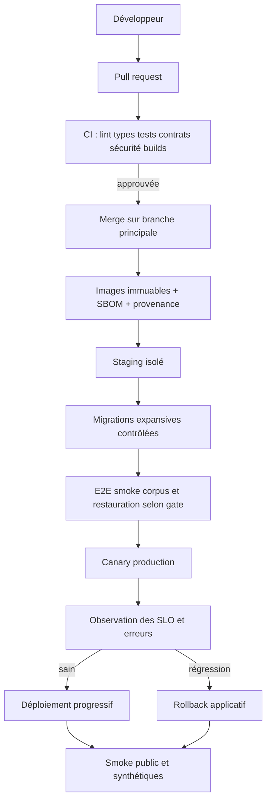

# 21 — Déploiement, maintenance et reprise après sinistre

## 1. Chaîne de livraison

La branche et le fournisseur CI réels sont configurés en phase 1 ; ce diagramme ne décrit pas un pipeline existant. Les releases sont immuables et identifiées par commit, digest d'image, schéma DB, versions de schéma de page et de renderer.

## 2. Environnements et promotion

`local` pour développement ; `ci` éphémère ; `staging` avec fournisseurs sandbox et DNS de test ; `production`. Les artefacts sont promus, non reconstruits avec des dépendances différentes. Chaque environnement a comptes, bases, buckets, clés et origines distincts. Les URLs et domaines sont configurés, jamais codés en dur.

Les migrations manuelles en production sont interdites sauf procédure d'incident enregistrée. Les changements d'infrastructure passent par plan revu et état protégé.

## 3. CI/CD et contrôles

PR : formatage, lint, types, tests unitaires/intégration/contrats, build, licences, scan secrets/dépendances/IaC/images, budgets de bundle. Revue obligatoire pour auth, tenancy, publication, domaines, facturation et migrations. La protection de branche et les règles CODEOWNERS sont définies lors de la fondation.

CD : signature/provenance si disponible, scan, déploiement staging, tests, approbation de production selon risque, canary, rollback. Les secrets CI sont à durée courte et permissions minimales ; pas de secret de production dans les PR de forks.

## 4. Stratégie de migration DB

- expansion : nouvelles colonnes/tables nullables ou defaults compatibles ; index concurrents en production ;
- code compatible ancien/nouveau schéma pendant la fenêtre ;
- backfill par petits lots, resumable, mesuré et pausable ;
- contraintes `NOT VALID` puis validation lorsque pertinent ;
- bascule de lecture/écriture avec feature flag ;
- contraction après stabilité et fin de fenêtre de rollback ;
- sauvegarde/PITR disponible et test de restauration avant changement risqué.

Rollback applicatif ne signifie pas toujours rollback de schéma. Les migrations destructrices ne sont pas annulées par un `down` improvisé ; on restaure ou on répare via migration avant.

## 5. Déploiement du renderer et compatibilité

Le canary reçoit une partie du trafic de gestion et un corpus de publications de test, pas arbitrairement des tenants sensibles sans contrôle. Les anciennes publications sont testées contre le nouveau renderer. Si la compatibilité n'est pas assurée, le routage garde la version de renderer indiquée par le manifeste ou les publications sont migrées/rebuildées de manière contrôlée.

Le rollback d'une release ne doit pas mélanger nouveau manifeste et ancien renderer incompatible. Les bundles immuables et les clés de cache par version rendent la bascule réversible.

## 6. Maintenance des dépendances

Lockfile et updates automatisés en PR avec tests ; cadence selon gravité ; revue des changements majeurs de Next/React/Nest/ORM ; pas de mise à jour automatique en production. Fenêtre de support des versions documentée. Les versions `latest` relevées dans l'audit sont un point de départ de recherche, jamais une consigne d'upgrade.

Correctifs critiques : tri immédiat, mitigation WAF/feature flag si nécessaire, patch et rotation des secrets si exposition. Les vulnérabilités non exploitables sont documentées plutôt que masquées.

## 7. Sauvegardes

| Actif | Méthode proposée | Fréquence/rétention à valider | Preuve |
|---|---|---|---|
| PostgreSQL | Snapshots + PITR managé | RPO cible 15 min ; rétention selon offre/légal | Restauration à un timestamp |
| Objets/bundles | Versioning, réplication si requise, lifecycle | Versions actives + fenêtre rollback | Reconstruction du manifeste et checksums |
| Configuration | Git/IaC et inventaires | Chaque changement | Redéploiement d'un environnement |
| Secrets | Coffre et procédure de régénération | Selon provider | Test de rotation, pas d'export en clair |
| DNS/TLS | Export/configuration et provider | Chaque changement | Restauration sur zone de test |
| Redis/outbox | Redis secondaire ; outbox PostgreSQL | Reconstructible | Rejeu sans double effet |

Les sauvegardes sont chiffrées, accès séparé et suppression soumise à rétention. Les tests vérifient également que les données restaurées ne sont pas exposées publiquement par un environnement de test.

## 8. Scénarios de reprise

### Perte/corruption PostgreSQL

Déclarer l'incident, figer les écritures si nécessaire, choisir le point de restauration, restaurer dans une nouvelle instance, valider contraintes/tenants/pointeurs, basculer via configuration, rejouer outbox et vérifier les effets externes. Le RPO/RTO mesuré est consigné.

### Perte Redis

Ne pas bloquer les sites publics si caches et bundles restent disponibles ; suspendre ou ralentir les nouvelles tâches ; recréer l'instance ; rétablir rate limits en mode dégradé ; reconstruire les files depuis outbox/états ; reprendre les jobs avec idempotence.

### Corruption d'objets ou bundle

Geler les purges, identifier les manifests/checksums, restaurer versions d'objets, reconstruire depuis sources si saines, activer la dernière publication saine. Ne jamais servir un objet dont le checksum ne correspond pas.

### Panne du CDN/provider edge

Basculer vers origine ou provider secondaire seulement si préparé et testé ; ajouter capacité d'origine et protections ; domaines custom/TLS rendent cette migration non triviale. Le runbook doit préciser ce qui est réellement possible, pas supposer un failover magique.

### Fuite de secret

Révoquer/rotation, invalider sessions si nécessaire, bloquer egress ou credentials, analyser usages, purger artefacts/logs exposés selon procédure, reconstruire et notifier selon obligations. La simple suppression du commit ne suffit pas.

### Région perdue

La V1 monorégion avec sauvegardes distantes implique une restauration dans une autre région avec RTO potentiellement long. Le multi-région actif-actif n'est pas promis. Si un RTO plus court devient contractuel, un ADR de réplication DNS/DB/objet et des exercices réguliers sont nécessaires.

## 9. Rollback et communication

Critères : SLO burn, erreurs P0, corruption, isolation, publication défaillante, latence ou coût anormal. Le responsable d'incident décide ; le déploiement automatique s'arrête sur métriques fiables. Rollback vers artefact précédent, désactivation du flag, restauration de publication ou activation du mode lecture seule.

Communication interne : incident, impact, actions, prochaine update. Communication utilisateurs : status page indépendante si possible, états précis, pas de détails sensibles. Post-mortem avec timeline, impact, causes techniques/organisationnelles, actions, propriétaires et dates.

## 10. Procédures de développement et d'évolution

1. Choisir une tâche du backlog et vérifier dépendances/acceptance IDs.
2. Créer ou mettre à jour ADR si décision structurante.
3. Écrire tests et contrat avant ou avec l'implémentation.
4. Ajouter migrations, permissions, métriques, erreurs, i18n et documentation.
5. Exécuter CI et revues ; déployer staging ; réaliser critères d'acceptation.
6. Activer progressivement avec flag et surveiller.
7. Nettoyer flags/code obsolète et mettre à jour la traçabilité.

Aucune évolution de schéma de page, API ou événement sans politique de compatibilité. Aucune extraction de microservice sans mesures et runbook.

## 11. Exercices et fréquence

Avant bêta : restauration complète, perte Redis, kill de publication, certificat, rollback renderer, secret. Ensuite : restauration trimestrielle, exercice d'incident critique au moins semestriel, revue d'accès trimestrielle, rotation selon politique, tests de charge avant changements majeurs. Les fréquences sont ajustées aux obligations et à la taille de l'équipe.

## 12. Preuves de fin de déploiement

Version et digests, résultats CI, migration appliquée, canary sain, smoke API/Studio/sites, publication et rollback de test, certificats et sondes, dashboards sans anomalie, sauvegarde vérifiée, notes de release et procédure de retour. Ces preuves sont rattachées à la release ; le présent dossier n'en fournit aucune puisqu'aucun déploiement n'a été effectué.
