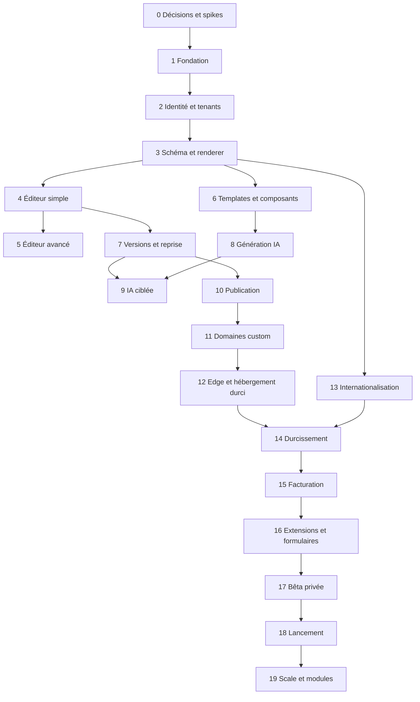

# 22 — Roadmap par dépendances

## 1. Lecture et engagements

La roadmap ordonne les travaux et les gates ; elle ne promet pas de date. Complexité : **S** quelques jours de travail d'une personne sur un périmètre connu, **M** une à quelques semaines, **L** plusieurs semaines et/ou prototypes, **XL** chantier à découper. Ces ordres de grandeur ne sont pas des estimations individuelles contractuelles.

Les phases peuvent se chevaucher lorsque leurs contrats sont stables. Une phase commencée n'est pas une phase terminée : les critères de sortie et les preuves du document 26 font foi.

## 2. Vue des phases et epics

| Phase | Epics principaux | Dépendances bloquantes | Gate de sortie |
|---|---|---|---|
| 0 — Audit/spécifications | Audit, scope, ADR, spikes, corpus | Dépôt inspecté ; sponsor produit | Décisions ouvertes prioritaires tranchées ; spikes documentés ; scope V1 approuvé |
| 1 — Fondation | Monorepo, toolchain, CI, environnements | Phase 0 pour choix de stack | Build/test reproductibles ; CI et conventions actives |
| 2 — Auth/workspaces | Identité, sessions, RBAC, invitations, audit de base | P1 | Isolation et matrice de rôles testées |
| 3 — Schéma/renderer | PageDocument, registre, migrations, renderer public minimal | P1 ; P2 pour les routes tenant | Corpus conforme ; preview/public projection sans outils d'édition |
| 4 — Éditeur simple | Canvas, commandes, contenu, sections, undo | P2/P3 | Parcours débutant et autosave de base fiables |
| 5 — Éditeur avancé/responsive | Arbre, inspecteur, styles, breakpoints, conflits | P4 | Fidélité/perf/accessibilité sur D1/D2 |
| 6 — Templates/composants | Bibliothèque, tokens, variantes, import/export | P3 ; P4 pour intégration | Registre V1, migrations et licences vérifiées |
| 7 — Versions/récupération | Autosave durci, checkpoints, diff, restauration | P4 ; DB P3 | Kill/conflit/reprise sans perte silencieuse |
| 8 — Génération IA | Provider port, plan, génération, validation, coûts | P3/P6 ; quotas techniques | Corpus et budget ; aucun code exécuté |
| 9 — IA conversationnelle | Patchs ciblés, diff, scope, undo | P7/P8 | Patch hors scope refusé ; conflit sûr |
| 10 — Publication/sous-domaines | Prévol, bundles, activation, rollback, slugs, SEO | P3/P7 ; infra de base P1 | Atomicité, kill tests, site accessible et rollback |
| 11 — Domaines/TLS | Vérification, DNS, certificats, routage custom | P10 ; provider choisi | Machine à états et renouvellement testés sur zone de test |
| 12 — Hébergement/CDN | Durcissement edge, caches, scaling, sauvegardes | P10 ; P11 pour custom | Charge, coût, failover dégradé et restauration mesurés |
| 13 — Internationalisation | Studio/catalogues, contenus, URLs, RTL selon scope | P3 pour contenu ; P10 pour SEO | Corpus locales/hreflang/fuseaux validé |
| 14 — Analytics/sécurité/perf | Observabilité, produit, menaces, budgets | Fondations de chaque parcours | Aucun finding P0 ; SLO/alertes et corpus verts |
| 15 — Facturation/quotas | Plans, entitlements, usages, PSP, marge | P2 ; usages P8/P10/P12 | Webhooks/impayés/quotas/marge testés |
| 16 — Extensions métier | Contrat extensions, Collections, formulaires | P3/P10/P15 selon offre | Formulaire sécurisé ; modules futurs non sur-vendus |
| 17 — Bêta privée | Onboarding, support, cohortes, correction | P0–P16 retenus pour bêta | Gates signés ; restauration et pentest ; cohortes stables |
| 18 — Lancement public | Offres, docs, statut, support, abuse, release | P17 | Go/no-go formel et rollback/runbooks prêts |
| 19 — Grande échelle | Optimisation, extraction, modules, collaboration | Mesures de P18 | Investissements justifiés par SLO/coût/produit |

## 3. Phase 0 — Audit et preuves de faisabilité

Travaux : valider les personas et le scope ; approuver les ADR provisoires ; vérifier les domaines et fournisseurs ; prototyper canvas/DnD/renderer ; tester une publication atomique sur infrastructure jetable ; évaluer DNS/custom hostnames ; établir un corpus et une baseline IA ; chiffrer les coûts ; réaliser revue de menace.

**Ne pas faire :** transformer les prototypes en plateforme complète, acquérir des dépendances sans licence, promettre des SLO ou lancer tous les modules métier.

## 4. Phases 1 à 3 — Chemin critique du socle

P1 met en place le monorepo, les packages et les contrats de qualité. P2 établit le tenant et la sécurité avant les données métier. P3 fige le contrat central : schéma, composants minimaux, migrations, projection et rendu. Le design system du Studio et les catalogues i18n peuvent commencer en parallèle, mais aucun éditeur complexe ne doit précéder le schéma.

**Gate P3 :** un document versionné peut être validé, migré, rendu en preview et publié dans un environnement de test sans importer le code d'édition ; deux workspaces ne peuvent pas se lire.

## 5. Phases 4 à 7 — Édition et confiance

P4 privilégie les actions simples et la sélection. P5 ajoute la complexité seulement après mesure. P6 développe le catalogue et les thèmes en parallèle avec P5 si le registre est stable. P7 durcit la conservation avant de brancher l'IA ou la publication.

La collaboration temps réel n'est pas sur le chemin critique. Les conflits V1 sont résolus par révisions et diff.

## 6. Phases 8 à 12 — Création assistée et mise en ligne

L'IA utilise le registre et le corpus ; elle ne définit pas son propre format. La génération et la conversation peuvent être développées en parallèle avec la préparation d'infrastructure, mais leurs gate exigent versions stables.

La publication sur sous-domaine précède les domaines custom. Le provider edge/DNS doit être choisi suffisamment tôt pour éviter de réécrire le routage. Le SSG sélectif et les optimisations de scale ne bloquent pas le premier parcours SSR.

## 7. Phases 13 à 16 — Internationalisation et exploitation commerciale

L'i18n structurelle doit être amorcée dès P1/P3 ; P13 finalise les langues, routes et corpus. L'observabilité et la sécurité sont continues ; P14 est un durcissement, pas leur première apparition. La facturation arrive après une mesure fiable des coûts, mais son modèle d'entitlements peut être préparé plus tôt.

P16 livre le contrat d'extensions, Collections limitées et formulaires. E-commerce, réservations, LMS et marketplace ne sont pas compris dans cette phase par défaut.

## 8. Phases 17 à 19 — Validation et croissance

La bêta privée utilise une cohorte limitée et représentative, support instrumenté, prix éventuellement non finalisés et aucune promesse publique de scale. Les critères de sortie incluent sécurité, restauration, qualité de l'éditeur, coût IA et succès de publication. Le lancement public exige offres, documentation, support, abuse et statut opérationnels.

P19 est déclenchée par les mesures : partitionnement, extraction de services, SSG sélectif, multi-région, collaboration, marché de templates et modules transactionnels. Chaque chantier a un business case et un ADR.

## 9. Chemin critique et parallélisation

Parallélisables après contrats : design system et i18n avec P1–P3 ; bibliothèque de composants avec P4–P5 ; corpus IA avec P4–P7 ; préparation cloud/DNS avec P4–P9 ; documentation et tests de charge avec P8–P12. Non parallélisables sans rework important : schéma avant éditeur ; tenancy avant données partagées ; versions avant IA destructive ; publication avant domaines custom ; mesures d'usage avant tarification à l'usage.

## 10. Scénarios de capacité

Ces fourchettes sont des hypothèses macro à recalibrer après P0, pour une V1 limitée au périmètre indiqué, hors modules transactionnels complets. Elles ne constituent pas un engagement.

| Scénario | Équipe stable supposée | Bêta privée indicative | Lancement public indicatif | Arbitrages nécessaires |
|---|---|---|---|---|
| Ressource très limitée | 2–3 ingénieurs, produit/design/ops à temps partiel | 12–18 mois | 15–24 mois | Éditeur avancé réduit, peu de langues/providers, IA limitée, modules P16 minimaux |
| Équipe produit resserrée | 5–7 ingénieurs + design/produit et QA/ops identifiés | 8–12 mois | 12–18 mois | Parallélisation limitée, scope V1 strict et gates hebdomadaires |
| Plusieurs pods | 8–12 ingénieurs avec leads, design, QA et ops | 6–9 mois | 9–15 mois | Seulement avec contrats stables ; coordination et revues renforcées ; pas de multiplication des modules |

Ajouter des personnes ne réduit pas linéairement le chemin critique. Une estimation fiable exige vélocité observée, disponibilité réelle, résultats des spikes et buffer pour sécurité, DNS et corrections de bêta.

## 11. Revue et pilotage

Chaque phase possède un propriétaire, des dépendances, une démonstration, des preuves de tests et une revue de risques. Les changements de scope comparent impact chemin critique, coût et dette. Les tâches P0 ne sont pas sacrifiées pour une date. La roadmap est revue à chaque gate, pas figée sur plusieurs années.

Le backlog atomique et les conditions de validation sont dans `23_TASK_BACKLOG.md` ; les critères mesurables dans `26_ACCEPTANCE_CRITERIA.md` ; la matrice de couverture dans `31_REQUIREMENTS_TRACEABILITY.md`.
